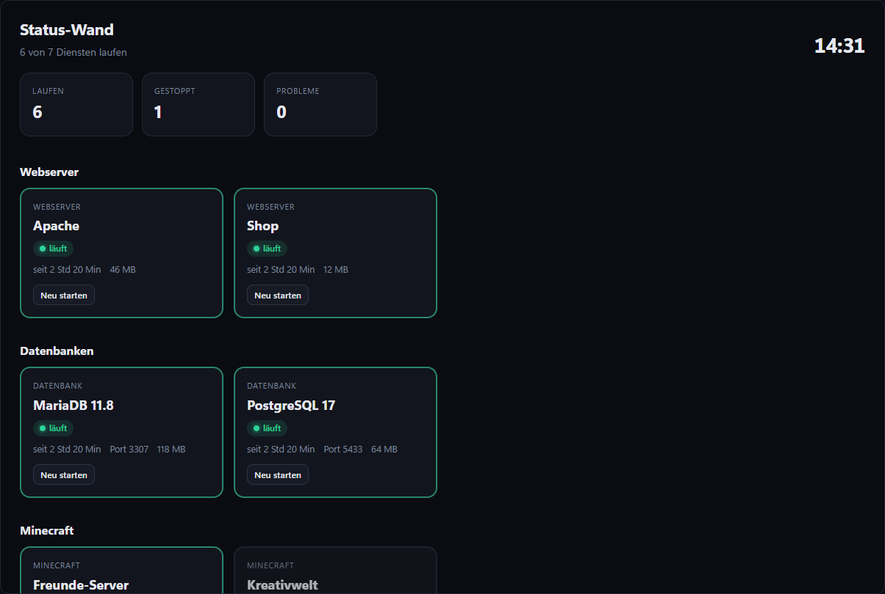

# Status-Wand

[English](README.md) · **Deutsch**

Alle Dienste groß und farbig auf einen Blick – ideal für einen zweiten Bildschirm oder das Tablet an der Wand. Ein Klick startet oder startet neu (Hostwerk fragt vorher).

## Funktionen

- Jeder Webserver, jede Datenbank, Minecraft-Server, App und der Mail-Fänger als Kachel
- Laufen / gestoppt / Probleme oben, Probleme zuerst
- Starten und neu starten mit Rückfrage
- Gruppen, gestoppte ausblenden, drei Kachelgrößen (auch „Wand“)
- Kachel mit Ring für die Übersicht: wie viele Dienste laufen
- Deutsch und Englisch, hell und dunkel

## Installieren

In Hostwerk (ab 2.9): **Apps → Erweiterungen → Marktplatz → Status-Wand → Installieren** (Abzeichen *Offiziell*).
Oder von Hand: `status-wall-1.0.0.zip` aus dem [neuesten Release](../../releases/latest) laden → *Apps → Erweiterungen → Datei*.

## Rechte

- `read:services` – Dienste sehen
- `control:services` – starten/neu starten, **Hostwerk fragt jedes Mal**

Läuft in Hostwerk abgeschottet – kein Zugriff auf Anmeldungen, Einstellungen oder Dateien.

## Selbst bauen

Dieses Repository ist auch ein Beispiel für das [Hostwerk-Erweiterungs-SDK](https://github.com/Passimoritz/hostwerk-public/blob/main/sdk/README.de.md): Design-Baukasten, Übersetzungen, Einstellungen, Speicher, Ereignisse, Prüfung und Releases.

Lizenz: MIT
