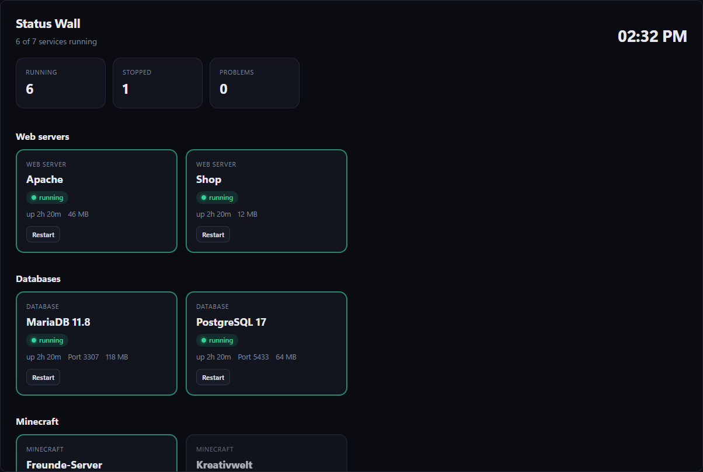
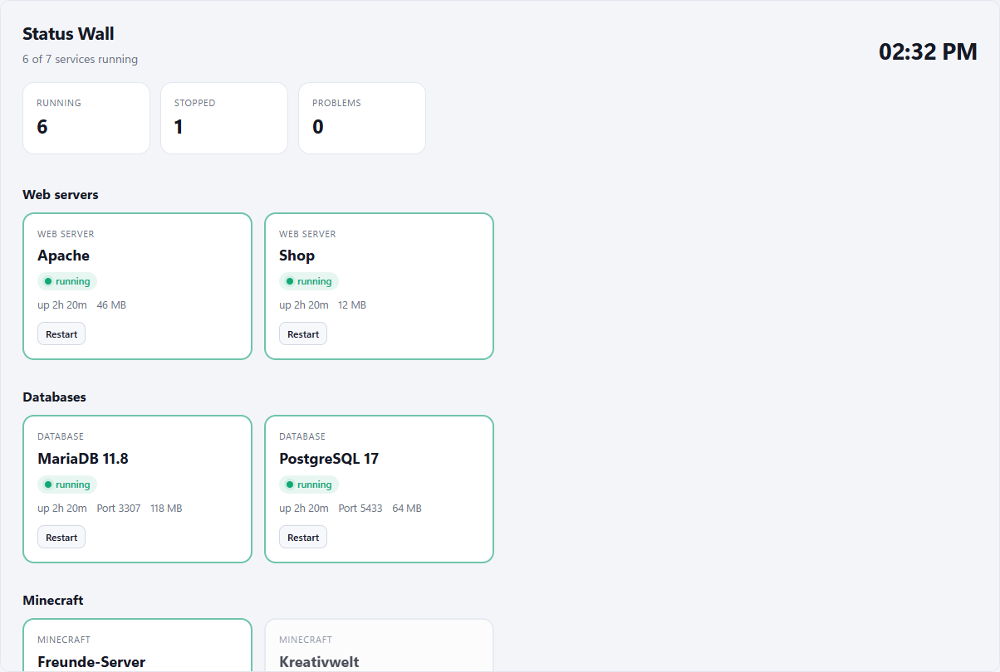

# Status Wall

> **Since 2.0 this also contains the former “Uptime wall”:** tabs “Reachability” and “Public status page”. Anyone who had the uptime wall gets this version automatically; Hostwerk removes the old one.

[Deutsch](README.de.md) · An official [Hostwerk](https://github.com/Passimoritz/hostwerk-public) extension (runs sandboxed, needs Hostwerk with SDK 3.8)

All services big and colourful at a glance – ideal for a second screen or a tablet on the wall. One click starts, stops or restarts a service (Hostwerk asks first).

| Dark | Light |
|---|---|
|  |  |

## What it does

- **Tabs:** Services · Reachability · Public status page – in Go live one tab “Status wall” with these sub tabs
- **Reachability:** every check from Go live → Monitoring big and colourful, with availability in 24 hours, average response time, outages and history (Ctrl+Alt+U)
- **Public status page:** visitors see without login whether your services run – only names, state, availability and history; title, text, which checks, own display names, renew the link, optionally write it into a website folder
- **Kiosk wall** optionally with the uptime checks too (setting, only name, state and availability); the tile shows one line about reachability
- Every web server, database, Minecraft and game server, app and the mail catcher as a tile (game servers can be started and stopped here too and open their own page)
- Running / changing / stopped / problems at the top, problems first – “starting” no longer counts as stopped
- Start, stop and restart with confirmation
- Reachability from the uptime checks next to the process state (“running, but not reachable”)
- Small CPU and memory history per tile (with a text alternative)
- Clear error state with “Try again”; refreshes only while the page is visible
- In Go live → Operate → Status wall (no own sidebar entry since 1.5), shortcut Ctrl+Alt+W
- Grouping, hide stopped services, three tile sizes (incl. “wall”)
- Dashboard tile with a ring: how many services run
- Kiosk wall without sign-in (`/v/status-wall/`) for a second screen or a tablet: read only, full screen button, `?theme=light`, `?size=compact|wall`, `?stopped=0`, `?group=0`, `?lang=de` – only after you switch on “Share the kiosk wall without sign-in”; no ports, paths or addresses
- German and English, light and dark mode

## Install

In Hostwerk (3.0 or newer): **Apps → Extensions → Marketplace → Status Wall → Install** (badge *Official*).
Or manually: download `status-wall-1.0.0.zip` from the [latest release](../../releases/latest) → *Apps → Extensions → File*.

## Permissions

- `read:services` – see services
- `control:services` – start/stop/restart, **Hostwerk asks every time**
- `read:system` – load per service for the small history
- `read:live` – results of the uptime checks
- `share:view` – the kiosk wall without sign-in (off until you share it)
- `native` – a small server part that answers the kiosk wall (read only)

Runs sandboxed in Hostwerk – no access to logins, settings or files.

## Develop

This repository is also an example for the [Hostwerk extension SDK](https://github.com/Passimoritz/hostwerk-public/blob/main/sdk/README.md): design kit, translations, settings, storage, events, check and releases.

## License

MIT
